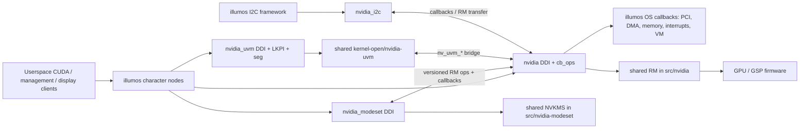
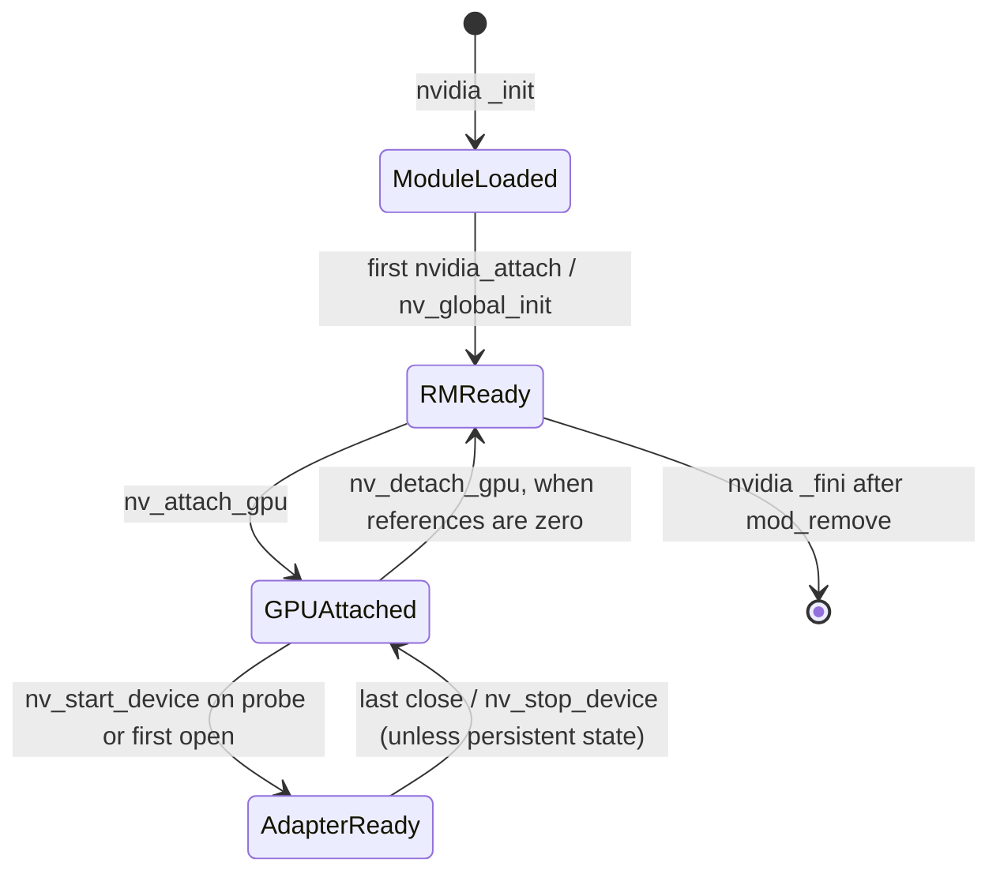

# Driver codebase walkthrough

This is a map for changing the **illumos/SmartOS port** of NVIDIA's 615.71.09 open GPU kernel modules. It follows the source on this branch; it does not imply that a particular GPU, firmware image, kernel, or userspace package has been tested. Read a source reference such as `kernel-illumos/nvidia/nvidia_ddi.c:659` as a location in this repository, not an external API specification. The Linux implementation remains useful for comparison, but illumos execution enters through `kernel-illumos/`.

## 1. What is in this repository

The core `nvidia` driver owns PCI GPU discovery, Resource Manager (RM) initialization, device files, memory and DMA, interrupt service, power management, and the OS callbacks used by shared RM. Three dependent modules provide display modesetting (`nvidia_modeset`), GPU I2C controllers (`nvidia_i2c`), and Unified Virtual Memory (`nvidia_uvm`). The actual nodes and the absence of illumos `nvidia-drm`/`nvidia-peermem` are listed in `kernel-illumos/README.md:1-17`. `nvidia` also contains NVLink and NVSwitch node handling; see `kernel-illumos/nvidia/nvidia_cb.c:348-456` and `kernel-illumos/nvidia/nvidia_ioctl.c:193-250`.

The illumos build is **amd64 only** (`kernel-illumos/Makefile:28-64`, output `SunOS_x86_64`). The upstream package's Linux architecture statements are not evidence of a working illumos arm64 port. The supported-ID alias generator consumes the table in the root `README.md` and adds NVSwitch IDs (`kernel-illumos/Makefile:247-269`); `rm_is_supported_pci_device()` and `rm_is_supported_device()` still decide whether a discovered device is accepted (`kernel-illumos/nvidia/nvidia_ddi.c:390-455`). Hardware behavior also depends on matching GSP firmware and userspace, neither of which is supplied here (`kernel-illumos/README.md:38-47`). The documented illumos UVM limits include IOMMU-attached GPUs, pageable HMM/ATS access, tools event queues, and 32-bit mappings (`kernel-illumos/README.md:97-114`).

```text
Makefile, utils.mk, version.mk      top-level OS selection, object build, version
README.md                           upstream GPU ID table and package context
src/nvidia/                         OS-neutral RM implementation -> nv-kernel.o
src/nvidia-modeset/                 OS-neutral NVKMS -> nv-modeset-kernel.o
src/common/                         shared RM/NVSwitch code and definitions
kernel-open/common/inc/             shared kernel interface declarations
kernel-open/nvidia/                 shared NVIDIA kernel glue (also used by illumos)
kernel-open/nvidia-uvm/             UVM implementation and source manifest
kernel-illumos/Makefile             four illumos module links and install layout
kernel-illumos/nvidia/              DDI, cb_ops, OS callbacks, GPU resources
kernel-illumos/nvidia-modeset/      NVKMS character device and illumos OS layer
kernel-illumos/nvidia-i2c/          illumos I2C controller provider
kernel-illumos/nvidia-uvm/          UVM device, segment, accounting, LKPI layer
kernel-illumos/common/inc/          cross-module illumos interfaces
kernel-illumos/tests/               focused host and illumos tests
kernel-illumos/docs/                investigation notes and validation evidence
```

The top-level `Makefile:28-67` first builds RM and NVKMS objects from `src/`, then selects `kernel-illumos` when `TARGET_OS=SunOS`; `utils.mk` supplies build variables. `kernel-illumos/Makefile:68-158` links illumos glue to the two shared objects, and `:159-244` links I2C and UVM. UVM's source list comes from `kernel-open/nvidia-uvm/nvidia-uvm-sources.Kbuild`; the illumos build substitutes its own kthread queue, ATS fault, and pageable population implementations and forces an LKPI header before shared UVM sources (`kernel-illumos/Makefile:175-242`). `-Ndrv/nvidia` records the module dependency of modeset, I2C, and UVM (`kernel-illumos/Makefile:139-165,210-216`). The build needs GCC, GNU binutils, and headers from a matching illumos tree (`kernel-illumos/README.md:19-29`). The core module links against illumos `gfx_private`, `acpica`, `pcie`, `sha2`, and `kcf`; the I2C module also depends on `drv/i2cnex` (`kernel-illumos/Makefile:109-110,160-166`). Crypto tests require illumos `libmd` and OpenSSL 3 (`kernel-illumos/tests/crypto/Makefile:1-18`).

## 2. Architectural mental model



The boundary is intentional: `nvidia_ddi.c` provides illumos `dev_ops`; `nvidia_cb.c` provides `cb_ops`; `nvidia_os.c`, `nvidia_dma.c`, `nvidia_mem.c`, `nvidia_pci.c`, and related files satisfy RM's OS interface. RM decides GPU policy and issues many hardware operations, so a `kernel-illumos/` call path commonly crosses into `src/nvidia/`. For display, `nvidia_modeset_illumos.c:195-238` negotiates a versioned RM operations table and registers callbacks with `nvidia_modeset_interface.c:31-95`; registration uses a writer lock and callback invocation a reader lock, so unregister waits for in-flight calls. I2C uses a similar callback boundary (`nvidia_i2c_interface.c:94-151`, `nvidia-i2c/nvidia_i2c.c:356-428`). UVM uses Linux-like `file_operations` from shared code behind illumos `cb_ops` (`nvidia-uvm/uvm_illumos.c:352-652`).

**The three main object lifetimes differ.** `nv_illumos_state_t` belongs to a DDI GPU attach and embeds RM's `nv_state_t` as its first member (`nvidia/nv-illumos.h:300-361`). `nv_illumos_file_private_t` belongs to a cloned open and embeds RM's `nv_file_private_t`, with a refcount, event queue, mapping list, and optional GPU pointer (`:232-281`). `uvm_va_space_t` belongs to a UVM file and owns VA ranges, registrations, and GPU VA spaces; creation and destruction are in `kernel-open/nvidia-uvm/uvm_va_space.c:269,578`, reached from `uvm.c:940-1000,202-292`. A GPU can be attached before its adapter is initialized; initialization can happen at attach or on first open (`nvidia_ddi.c:524-545`, `nvidia_gpu.c:411-473`). Do not equate DDI attachment, RM initialization, adapter initialization, and a UVM VA space.



This diagram describes the ordinary GPU path; excluded GPUs, failed init, persistent software state, suspend/resume, and NVSwitch have branches detailed below. `nvidia_attach()` dispatches by pseudo device, GPU, or NVSwitch (`nvidia_ddi.c:659-725`).

### State, synchronization, and ownership

| State or lock | Meaning and rule | Source |
| --- | --- | --- |
| `nv_global_lock`, `nv_rm_initialized`, `nv_init_sp` | Serialize lazy global RM setup; `nv_global_init()` asserts the mutex and unwinds each initialized subsystem on error. | `nvidia_ddi.c:123-233` |
| `nv_illumos_devices_lock`, `nv_illumos_devices`, `nv_minor_bitmap` | Protect GPU list and minor assignment/removal; detach takes writer lock before `ldata_lock`. | `nvidia_ddi.c:509-543,597-618`; `nv-illumos.h:300-319` |
| `nvis->ldata_lock`, `usage_count` | Serialize open/close/start/stop; a positive usage count blocks detach. Kernel clients use `nvidia_dev_get/put()`, not only user opens. | `nvidia_gpu.c:411-515`; `nvidia_ddi.c:597-607` |
| `nvis->isr_lock`, pending bits | Serialize RM ISR across MSI-X vectors; atomic pending bits coalesce bottom-half taskq dispatch. | `nvidia_intr.c:108-163` |
| `nvifp->ref_lock`, `fp_lock`, `file_va_lock` | Respectively protect open lifetime, interrupt-reachable event queue, and RM mmap context/list. A mapping may outlive an ioctl. | `nv-illumos.h:242-280`; `nvidia_cb.c:459-480,550-618,679-769` |
| `nvis->mmap_lock`, `open_files`; `nv_devmap_priv_t` | Track live opens and devmap handles for revocation; sysmem mappings hold an `nv_illumos_alloc_t` reference. | `nv-illumos.h:279-351`; `nvidia_mmap.c:45-90` |
| UVM `uvm_files_lock`, `uvm_start_lock`, PM lock | Clone-file lookup, one-time start, and shared-UVM power management gate; UVM release can be deferred while PM lock is unavailable. | `nvidia-uvm/uvm_illumos.c:305-326,352-477`; `kernel-open/nvidia-uvm/uvm.c:186-292,1065-1080` |

`nv_illumos_alloc_t` is the OS allocation descriptor with refcount, page table, and DMA chunks (`nv-illumos.h:149-195`). `nv_alloc_pages()` allocates RM-visible pages and a page table (`nvidia_mem.c:563-619`); DMA mapping uses DDI DMA handles/cookies (`nvidia_dma.c:150-300`). `os_lock_user_pages()` instead pins user memory through `umem_lockmemory()` and a long-term callback (`nvidia_umem.c:812-943`). Both paths require paired teardown; map/unmap must preserve the original bus-address and ownership contract. `nv_devmap_priv_t` represents *one* `devmap(9E)` mapping, including copies and partial unmaps (`nv-illumos.h:283-298`, `nvidia_mmap.c:45-150`).

## 3. Concepts to learn before editing

| Concept | Why it exists; where to start |
| --- | --- |
| **DDI lifecycle** | illumos calls `dev_ops.devo_attach/devo_detach` for device instances and `cb_ops` for file operations. A pseudo node can create control, modeset, I2C, or UVM services without a PCI function. See `nvidia_ddi.c:659-816`, `nvidia_cb.c:775-806`, `nvidia-uvm/uvm_illumos.c:650-723`. |
| **RM vs OS layer** | RM is the shared GPU manager; illumos implements its OS callbacks and links the resulting `nv-kernel.o`. Investigate the caller and callback together. See `kernel-illumos/Makefile:68-127`, `nvidia_ddi.c:123-188`, `nvidia_os.c:359-377`. |
| **Clone minor** | Every open gets a unique minor and per-open private state, allowing independent ioctl/mmap/event state. Base minors cannot be reopened as clones. See `nv-illumos.h:90-139`, `nvidia_cb.c:48-117,348-456`, `nvidia-uvm/uvm_illumos.c:352-477`. |
| **BAR and DMA address** | BARs are PCI device apertures; a CPU physical address, DMA bus address, and virtual mapping are different values. `nvidia_pte_t` carries all three (`nv-illumos.h:142-147`); attach maps BARs and detects DMA remapping (`nvidia_ddi.c:427-448`); DMA uses `nvidia_dma.c`. |
| **GSP** | Firmware is outside this tree and must match the module/userspace version; attach sets the RM firmware request, while adapter init brings the device up (`nvidia_ddi.c:489-491`, `nvidia_gpu.c:207-311`, `kernel-illumos/README.md:43-47`). |
| **UVM VA space and range** | A UVM file describes managed/external virtual address ranges and registered GPUs. ioctl routes live in `kernel-open/nvidia-uvm/uvm.c:1010-1080`; range/map code lives in `uvm_va_space.c`, `uvm_va_range.c`, and `uvm_map_external.c`. VA-space locking helpers are declared in `uvm_va_space.h:485-537`. |
| **illumos segment/HAT** | The segment driver backs process VM mappings and calls the hardware-address translation layer (HAT) on faults. `uvm_seg_segmap()` requires shared, native-64-bit, VA-equals-offset mappings; `uvm_seg_fault()` dispatches to UVM's VMA fault handler. The declared order is AS lock -> UVM locks -> file `am_lock` -> HAT locks; translations use paired `HAT_LOAD_LOCK`/`HAT_UNLOAD_UNLOCK` (`nvidia-uvm/uvm_seg.c:27-36,327-390,565-598`). |
| **NVKMS/I2C callback registration** | Optional dependent modules register with `nvidia` after their own setup; callback locks protect unload and probing. See `nvidia_modeset_interface.c:31-129`, `nvidia_modeset_illumos.c:195-238,831-974`, `nvidia_i2c_interface.c:94-151`. |

## 4. Lifecycle through actual entry points

1. **Module load.** illumos calls `nvidia` `_init()`, which creates stack cache, global/list locks, error, modeset/I2C, interrupt, PM, umem, UVM bridge, and clone state before `mod_install()` (`nvidia_ddi.c:820-878`). Modeset `_init()` sets up its queues/timers, obtains the versioned RM ops, calls `nvKmsModuleLoad()`, registers callbacks, then installs the DDI driver (`nvidia_modeset_illumos.c:831-953`). UVM `_init()` allocates clone/worker/KPI/page state and installs its DDI driver; shared UVM is deliberately **not** started yet (`nvidia-uvm/uvm_illumos.c:754-804`). I2C `_init()` is at `nvidia-i2c/nvidia_i2c.c:583-602`.
2. **First attach and discovery.** `nvidia_attach()` takes `nv_global_lock`, invokes `nv_global_init()` once, then dispatches control/NVSwitch/GPU instances (`nvidia_ddi.c:659-696`). Global init loads registry settings and RM, queues, caps, IMEX, and NVLink (`:123-204`). `nv_attach_gpu()` reads PCI IDs/BDF, waits for BAR firewall, rejects unsupported PCI IDs, allocates `nv_illumos_state_t`, maps BARs, sets DMA devices, detects IOMMU remapping, enables bus mastering, initializes locks and RM private state (`:350-474`). Failure exits unwind through labeled cleanup (`:555-575`).
3. **GPU publication and adapter start.** Attach assigns a minor, creates `/dev/nvidiaN`, optionally calls `nv_start_device()` according to `NVreg_GpuInitOnProbe`, then publishes the GPU in `nv_illumos_devices`, notifies RM, modeset, and I2C, and attaches the console (`nvidia_ddi.c:509-552`). `nv_start_device()` obtains power, allocates stacks, sets up interrupts and taskq, calls `rm_init_adapter()`, registers ACPI notification, and marks `NV_FLAG_INITIALIZED`; failure unwinds those resources (`nvidia_gpu.c:207-311`). The attach path logs an adapter-init failure but continues publishing the GPU (`nvidia_ddi.c:524-543`): probe success does not prove adapter readiness.
4. **Open and request.** `nvidia_open()` checks base minor/type, allocates clone state and stack, then routes control/GPU/capability/NVLink/NVSwitch. GPU open takes `ldata_lock`, calls `nv_open_device()`, and inserts the file into `open_files`; console `kcred` has a special fallback when RM open fails (`nvidia_cb.c:348-456`). `nv_open_device()` starts an uninitialized adapter and increments `usage_count` only on success (`nvidia_gpu.c:411-457`). `nvidia_ioctl()` validates encoded command/size, copies the payload, handles local commands, and sends the default case to `rm_ioctl()` (`nvidia_ioctl.c:91-139,193-517`). `nvidia_segmap()` checks RM-granted protection; `nvidia_devmap()` chooses sysmem or device memory mapping (`nvidia_cb.c:679-769`, `nvidia_mmap.c:229-390`).
5. **Interrupt/asynchronous work.** Interrupt setup chooses MSI-X, MSI, then fixed interrupts (`nvidia_intr.c:180-316`). `nvidia_isr()` serializes RM ISR calls, handles RM MMU faults, invokes UVM top half, calls `rm_isr()`, and queues a locked or unlocked bottom half as needed (`:128-163`). RM events are queued per file and exposed through poll/event ioctl (`nvidia_cb.c:550-618`, `nvidia_ioctl.c:420-500`). Modeset has its own kthread queues and timers (`nvidia-modeset/nvkms_q.c:39-207`, `nvkms_os.c:445-625`); UVM has worker and deferred-release paths (`nvidia-uvm/uvm_illumos.c:250-297`, `kernel-open/nvidia-uvm/uvm.c:186-292`).
6. **UVM startup and memory faults.** `uvm_dev_open()` calls `uvm_start()`. That checks RM readiness, applies properties, and invokes `nv_uvm_module_init()` on an expanded stack; failed startup may retry on the next open (`nvidia-uvm/uvm_illumos.c:298-326,352-425`). Shared `uvm_init()` initializes global state, character-device callbacks, and tools (`kernel-open/nvidia-uvm/uvm.c:1176-1223`). `uvm_dev_ioctl()` calls shared `file_operations` through `uvm_stack_call()` (`nvidia-uvm/uvm_illumos.c:490-561`); `uvm_ioctl()` routes commands to exact `uvm_api_*` handlers (`kernel-open/nvidia-uvm/uvm.c:1010-1080`). For mappings, `uvm_dev_segmap()` -> `uvm_seg_segmap()` -> `as_map(..., uvm_seg_create)`; CPU faults reach `uvm_seg_fault()` -> `uvm_seg_vm_fault()` -> shared VMA fault ops (`nvidia-uvm/uvm_illumos.c:567-582`, `uvm_seg.c:327-390,500-598`).
7. **Close, detach, unload.** `nvidia_close()` marks a file closing and drops its reference. Final destroy waits for event posting, cleans RM file state/mappings, removes the open, and calls `nv_close_device()`; last use may call `nv_stop_device()` (`nvidia_cb.c:263-322,459-480`, `nvidia_gpu.c:459-473,342-383`). GPU detach first asks modeset to drop its reference, rejects live usage or console opens, removes the device/list/minor, stops the adapter, releases RM private state and DDI resources (`nvidia_ddi.c:578-655`). `_fini()` refuses live umem locks, calls `mod_remove()`, then shuts down global RM and module services (`:880-909`). UVM `_fini()` explicitly refuses live files, segments, pins, external imports, or suspended PM state before shared UVM exit (`nvidia-uvm/uvm_illumos.c:806-840`). Modeset `_fini()` refuses open handles and drains callbacks/queues (`nvidia_modeset_illumos.c:831-974`).

```mermaid
sequenceDiagram
  participant U as userspace
  participant D as illumos DDI / cb_ops
  participant R as shared RM
  participant V as UVM
  participant G as GPU
  U->>D: open /dev/nvidiaN
  D->>D: clone + ldata_lock
  D->>R: nv_start_device -> rm_init_adapter (if needed)
  D-->>U: cloned fd
  U->>D: ioctl / mmap
  D->>R: rm_ioctl / RM mapping context
  R-->>D: status or mapping permission
  D-->>U: result
  G->>D: interrupt
  D->>V: UVM top half
  D->>R: RM ISR and queued bottom half
  U->>D: close
  D->>R: cleanup file; stop on last use
```

## 5. High-value paths when investigating a bug

| Path | Follow this exact chain | Invariant / likely failure boundary |
| --- | --- | --- |
| GPU attach | `nvidia_attach` -> `nv_global_init` -> `nv_attach_gpu` -> `rm_init_private_state` -> optional `nv_start_device` (`nvidia_ddi.c:123-204,350-575,659-696`) | PCI ID/BAR resources, RM support, minor allocation, and adapter init are separate checks. Attach can succeed after optional init failure. |
| GPU open/close | `nvidia_open` -> `nv_open_device` -> `nv_start_device`; `nvidia_close` -> `nv_file_private_destroy` -> `nvidia_close_gpu` -> `nv_close_device` (`nvidia_cb.c:263-322,348-480`; `nvidia_gpu.c:411-473`) | `ldata_lock` serializes usage and start/stop. The console fallback has no RM usage reference. |
| RM ioctl | `nvidia_ioctl` -> size/type validation -> `ddi_copyin` -> local switch or `rm_ioctl` -> `ddi_copyout` (`nvidia_ioctl.c:91-139,193-517`) | Never trust user size, nested transfer size, model, or console ioctl permissions. `NV_STATUS` conversion and errno are distinct. |
| Mapping | RM installs `file_mapping_list` via `nv_acquire_file_va` -> `nvidia_segmap` -> `devmap_setup` -> `nvidia_devmap` -> `nv_devmap_sysmem`/`nv_devmap_devmem` (`nvidia_cb.c:679-785`; `nvidia_mmap.c:45-390`) | Mapping permission, allocation refs, and revocation must survive duplication/partial unmap and file close. |
| DMA/locked RAM | RM OS callback `nv_alloc_pages` -> `nv_alloc_dma_chunks`; map via `nv_dma_map_alloc`; user pages via `os_lock_user_pages` -> `umem_lockmemory` (`nvidia_mem.c:403-619`; `nvidia_dma.c:150-300`; `nvidia_umem.c:812-943`) | Keep physical, bus, and CPU VA distinct. Check error unwinds and delayed callback cleanup. |
| Interrupt and fault | `nvidia_isr` -> `rm_gpu_handle_mmu_faults` -> `nv_uvm_top_half` -> `rm_isr` -> taskq bottom half (`nvidia_intr.c:73-163`) | ISR code must respect interrupt priority and avoid sleeping; `isr_lock` protects nonreentrant RM ISR. |
| UVM ioctl/import | `uvm_dev_ioctl` -> shared `file_operations.unlocked_ioctl` -> `uvm_ioctl` -> `uvm_api_map_external_allocation` (`uvm_illumos.c:490-561`; `uvm.c:1010-1080`; `uvm_map_external.c:1131-1273`) | Check VA-space locks, GPU registration, RM handle lifetime, and revoke-before-free (`uvm_map_external.c:1426-1549`). |
| UVM CPU fault | `uvm_dev_segmap` -> `uvm_seg_segmap` -> `uvm_seg_create`; later `uvm_seg_fault` -> `uvm_seg_vm_fault` -> shared VMA fault op (`uvm_illumos.c:567-582`; `uvm_seg.c:327-390,500-598`) | Native 64-bit, shared, VA-equals-offset map; managed pages reject softlock. |
| Modeset/I2C hotplug | `nv_attach_gpu` -> `nvidia_modeset_probe` / `nvidia_i2c_probe` -> registered callbacks (`nvidia_ddi.c:539-545`; `nvidia_modeset_interface.c:98-148`; `nvidia_i2c_interface.c:129-151`) | Registration and detach must not race callbacks; I2C uses an attach generation to reject stale controllers. |

## 6. Debugging and validation workflow

Start at the **first failing boundary**, then inspect the object that owns it: `nvis` for attach/interrupt/power, `nvifp` for RM ioctl/mmap/event, `linux_file`/`uvm_va_space_t` for UVM. Useful breakpoint candidates (recommended, not a repository-provided script) are `nvidia_attach`, `nv_attach_gpu`, `nv_start_device`, `nvidia_open`, `nvidia_ioctl`, `nvidia_isr`, `uvm_start`, `uvm_dev_ioctl`, `uvm_seg_fault`, `nv_detach_gpu`, and `uvm_va_space_destroy` (definitions cited above). At attach failures inspect `nv->flags`, PCI IDs/BDF, BARs, `nvis->dma_remap`, and the first failed RM return. At close/detach inspect `usage_count`, `console_open_count`, `open_files`, file refcounts, UVM live-file/segment/pin/import counts, and outstanding DMA/umem mappings (`nvidia_ddi.c:597-655`; `uvm_illumos.c:806-840`).

Available diagnostics are `nv_printf`/`NV_DEV_PRINTF` filtered by `cur_debuglevel` (`nvidia_os.c:70,359-377,547-567`), `dev_err`/`cmn_err` in the OS layer, `ASSERT` in lock-sensitive paths, and `DTRACE_PROBE3(dev__xid)` for GPU Xid reports (`nvidia_misc.c:403`) plus an NVSwitch SXid probe (`nvidia_nvswitch_os.c:614`). `kernel-illumos/Makefile:31-46,121-125` builds frame pointers and optionally CTF, which makes illumos `fbt`/MDB examination more useful. **Recommended on a test SmartOS host:** inspect kernel messages and loaded modules, use `mdb -k` for state/stack inspection and DTrace `fbt` for call timing. These are operating-system tools, not commands validated in this checkout. Preserve the first error and relevant call trace; a later `ENXIO`, `EIO`, or busy detach may only be a consequence. Existing runtime investigation evidence and MDB examples are in `kernel-illumos/docs/cuda-h2d-cache-alias.md:52-84`.

The repository documents this build procedure (`kernel-illumos/README.md:19-47`):

```sh
gmake modules ILLUMOS_SRC=/path/to/matching/illumos-gate
gmake modules_install DESTDIR=/
```

Run these on a compatible illumos build/target environment with GCC and GNU binutils, matching kernel headers, matching userspace, and matching GSP firmware. `kernel-illumos/README.md:30-47` gives the `update_drv`/`add_drv` and `devlink.tab` registration steps; review those against the actual host before changing a live system. For load/unload investigations, first check open FDs and mappings and unload dependents before `nvidia`; the source-enforced busy gates are above. This document does not claim a successful local build, install, module load, or hardware test.

For focused tests, the **defined** targets are `gmake -C kernel-illumos/tests/dma check`, `gmake -C kernel-illumos/tests/umem check`, and `gmake -C kernel-illumos/tests/crypto check` (`tests/dma/Makefile:25-58`, `tests/umem/Makefile:25-43`, `tests/crypto/Makefile:1-27`). They are userland tests, including contract/source checks, not a substitute for GPU tests. Crypto requires illumos libmd and OpenSSL 3; console tests are documented for a native illumos zone with NVIDIA `/dev/fb` (`tests/crypto/Makefile:1-18`, `tests/console/Makefile:1-20`). Built-in UVM ioctls require `uvm_enable_builtin_tests=1` and `sys_config` privilege (`kernel-illumos/README.md:152-160`, `nvidia-uvm/uvm_illumos.c:515-533`). The root `Makefile:79-89` also defines `gmake cscope` to index the source tree for navigation.

## 7. Changing the driver safely

| Change | Likely starting point | Preserve |
| --- | --- | --- |
| New PCI/platform behavior | `nvidia_ddi.c`, `nvidia_pci.c`, then RM call sites | Attach unwind, BAR validation, ownership of PCI/DMA handles, init-on-probe branches. |
| New user ioctl or node | `nvidia_cb.c`, `nvidia_ioctl.c`, shared interface headers/RM | Clone lifetime, command size/model validation, user-copy and privilege boundaries. |
| DMA or memory mapping fix | `nvidia_dma.c`, `nvidia_mem.c`, `nvidia_mmap.c`, `nvidia_umem.c` | Physical/bus/VA distinction, allocation refs, cache type, callback-driven revocation and failure unwind. |
| UVM managed-memory feature | `kernel-open/nvidia-uvm/` handler plus `nvidia-uvm/uvm_seg.c` and LKPI | VA-space locking, fault context, segment/HAT semantics, unavailable HMM/ATS features. |
| Display or I2C feature | `nvidia_modeset_illumos.c`/`nvkms_os.c`, or `nvidia_i2c.c`/`nvidia_i2c_interface.c` | Versioned RM ops, callback-unregister barrier, stale I2C attach generation. |
| Interrupt/PM change | `nvidia_intr.c`, `nvidia_gpu.c`, `nvidia_pm.c` | ISR nonreentrancy, taskq drain, UVM/modeset callbacks, `ldata_lock` ordering. |

Examples: a new device property belongs in the illumos property/registry bridge (`nvidia_registry.c`, `nvidia-uvm/uvm_illumos_params.c`) and its consumer, with defaults and invalid-value behavior checked. A new RM-backed mmap type needs a matching RM mapping context, `nvidia_segmap()` permission gate, `nvidia_devmap()` choice, allocation reference, and revocation path. A new UVM ioctl needs the `uvm_ioctl()` route, any LKPI support it assumes, and a check that `uvm_dev_ioctl()`'s 32/64-bit and privilege handling remains valid. These are implementation guides, not claims that such features already exist.

High regression risk lies at boundaries: changing shared `src/` or `kernel-open/` behavior can affect Linux too; changing illumos shim assumptions can break shared code without changing its source. `kernel-illumos/README.md:97-104` describes a carried illumos block in shared `uvm_mmu.c`, so upgrades should compare that integration point. An allocation should only be released after every GPU import/mapping is revoked and all asynchronous owners are drained; the checked revoke path is in `uvm_map_external.c:1426-1549`, and pinned user-memory cleanup is in `nvidia_umem.c:650-783`. Keep failure returns visible: a busy or failed release must not silently turn into a successful free.

## 8. Recommended reading order

1. **Architecture:** `kernel-illumos/README.md:1-17`, `kernel-illumos/Makefile:68-244`, `nvidia/nv-illumos.h:90-361`; draw the RM/OS/UVM/NVKMS boundaries.
2. **Initialization and lifecycle:** `nvidia_ddi.c:123-233,350-725,820-909`, `nvidia_gpu.c:207-383`, `nvidia-uvm/uvm_illumos.c:298-425,754-840`; distinguish module load, attach, adapter start, and first UVM open.
3. **Main operational path:** `nvidia_cb.c:348-480,679-810`, `nvidia_ioctl.c:91-139,193-517`, `kernel-open/nvidia-uvm/uvm.c:1010-1080`, `nvidia-uvm/uvm_seg.c:327-390,565-598`; trace one ioctl and one mmap/fault end to end.
4. **Concurrency/resources:** `nvidia_intr.c:73-163,180-316`, `nvidia_dma.c`, `nvidia_mem.c:403-650`, `nvidia_umem.c:650-943`, `kernel-open/nvidia-uvm/uvm_va_space.c:578-916`, `uvm_map_external.c:1426-1549`; write down each object's last owner and lock order.
5. **Debugging/testing:** `nvidia_os.c:359-377,547-605`, `nvidia_misc.c:403`, `kernel-illumos/tests/*/Makefile`, `kernel-illumos/docs/cuda-h2d-cache-alias.md`; reproduce a specific boundary failure with first-error logs and then inspect the owning state.

## 9. Scope and open questions

This source audit follows the illumos control, GPU, modeset, I2C, and UVM entry paths. It does **not** trace every RM internal call below `rm_init_adapter()`/`rm_ioctl()`, each UVM migration/page-fault algorithm, the NVSwitch state machine, every suspend/resume branch, or firmware protocol. Those require focused investigations with a concrete failure or feature. The exact tested SmartOS kernel revision, GPU inventory, firmware/userspace package, successful build output, and runtime load/unload behavior are not established by source inspection here. The root GPU ID table and alias generation are discovery inputs, not a hardware validation report.

## See also

- [illumos build and configuration](../kernel-illumos/README.md)
- [CUDA cache-alias investigation](../kernel-illumos/docs/cuda-h2d-cache-alias.md)
- [focused UVM/DMA tests](../kernel-illumos/tests/dma/Makefile)
